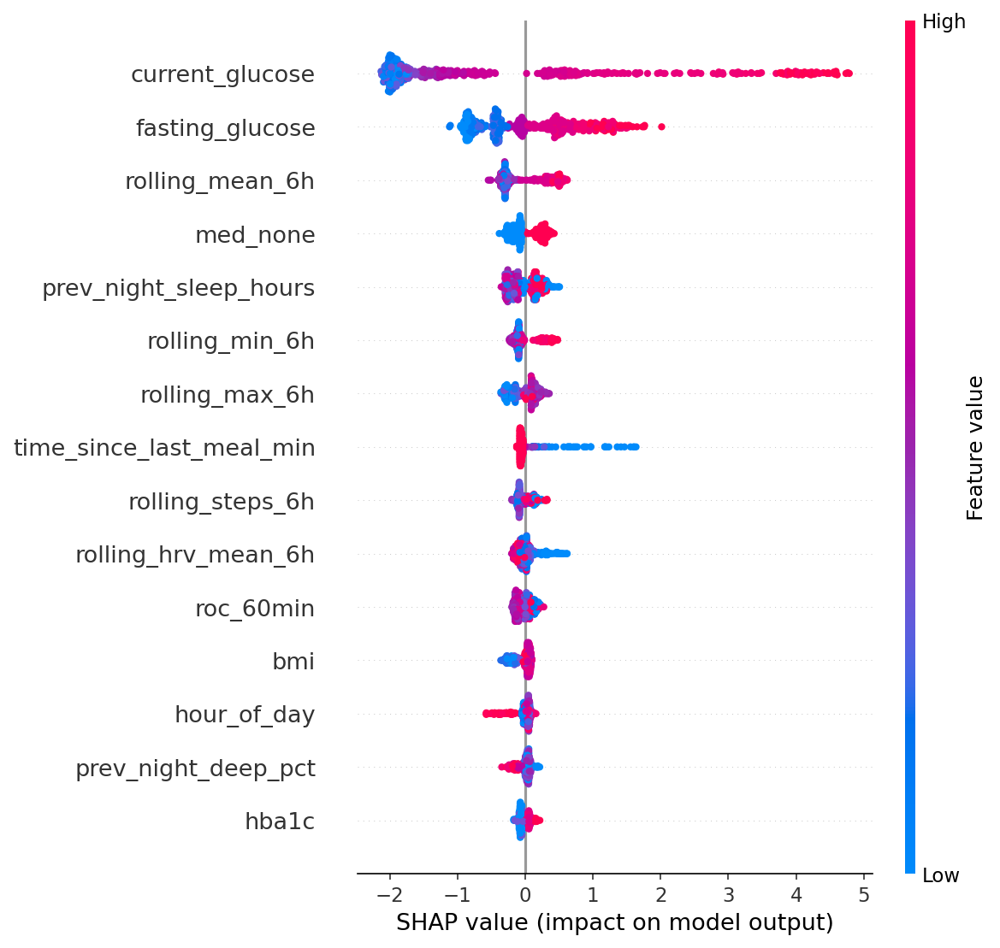
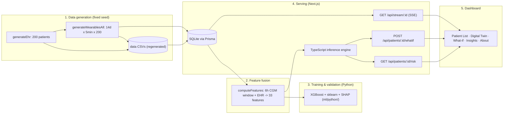
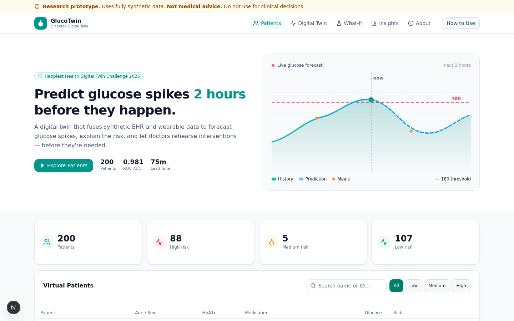
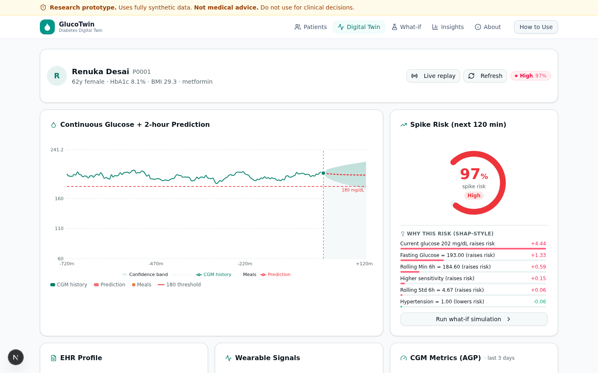
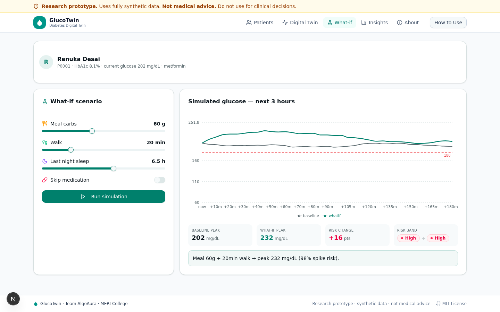
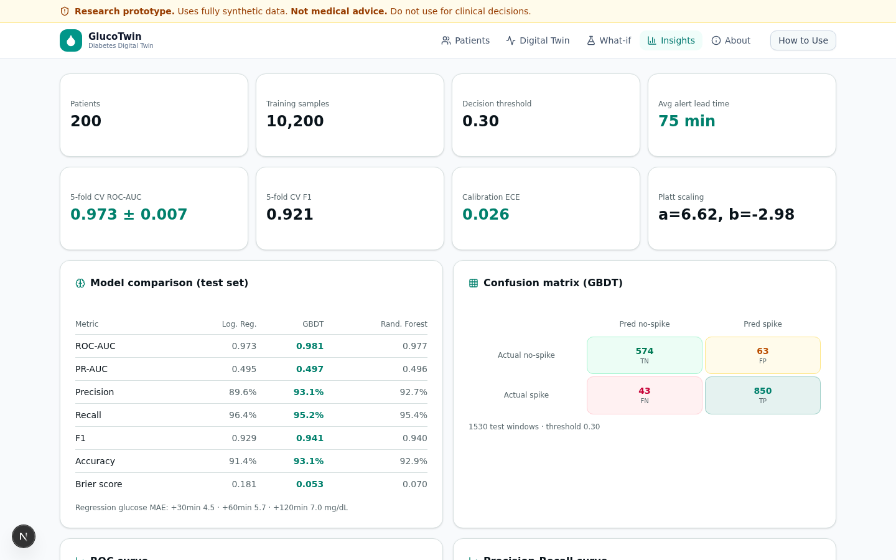

# GlucoTwin — A Type 2 Diabetes Digital Twin

> A clinician-facing digital twin that predicts a T2DM patient's glucose spike **~75 minutes before it happens**, explains *why* with SHAP, and lets a doctor rehearse "what-if" actions — fusing static EHR records with continuous CGM + wearable streams.

**🔴 Live demo:** **https://algoaura-meri-college-of-engineering-and.onrender.com/** *(hosted on Render's free tier — if it has been idle for a while, the first load can take up to a minute while the service wakes up)*

> **Disclaimer:** Research prototype. All data is synthetic. This is **not medical advice** and must not be used for clinical decision-making.

### README contents (submission checklist)

| Required item | Where in this README |
| --- | --- |
| Team details | [Team details](#team-details) |
| College / Incubator information | [College / Incubator information](#college--incubator-information) |
| Project title | This page title — **GlucoTwin** |
| Problem statement | [Problem statement](#problem-statement) |
| Healthcare use case | [Healthcare use case](#healthcare-use-case) |
| Technical stack | [Technical stack](#technical-stack) |
| AI/ML model / framework details | [AI/ML model details](#aiml-model-details) |
| 15–20 min demo video (unlisted YouTube) | [Demo video](#demo-video) |
| Open-source license | [Open-source license](#open-source-license) |
| Architecture diagram (PDF) | [Architecture diagram](#architecture-diagram) |
| Presentation (PPT) | [Presentation](#presentation) |
| Public accessibility | [Public accessibility](#public-accessibility) |

---

## Team details

- **Team name:** AlgoAura
- **Members:**
  - **Nishu Raj** — Team Leader
  - **Vishesh Pratap Singh** — Member
- **Hackathon:** Happiest Health "Digital Twin Challenge 2026"

## College / Incubator information

**MERI College of Engineering and Technology**, New Delhi — Department of Computer Science & Engineering. The project was developed as part of the college's hackathon programme; no external incubator was involved.

---

## Problem statement

India is the diabetes capital of the world. The ICMR **INDIAB** study (published 2023) estimates that **~101 million Indians** are living with diabetes and a further **~136 million are prediabetic**. Uncontrolled post-prandial and post-exercise glucose spikes drive the long-term micro- and macrovascular complications that account for the bulk of diabetes-related healthcare cost in India.

Today, most T2DM care in India is **reactive**: a patient visits a clinician every few months, an HbA1c is measured, and medication is adjusted long after the damage is done. Continuous glucose monitors are becoming affordable, but they only show the **past** — they do not tell a patient or a doctor that a spike is about to happen, *why*, or what to do about it.

GlucoTwin asks a small, sharp question:

> *Given the last 6 hours of a patient's CGM + wearable signals and their EHR, what is the probability that glucose will spike above 180 mg/dL in the next 120 minutes — and what can the patient do right now to avoid it?*

## Healthcare use case

The twin gives clinicians **early warning** (average **77.5 minutes of lead time** on correct alerts, held-out test set), **explainable predictions** (real SHAP values + human-readable reasons), and a **physiological what-if simulator** (walk 20 minutes, halve the meal, don't skip medication).

The intended deployment is a **clinician-facing dashboard in a primary-health-centre or telemedicine setting**, where one doctor can triage dozens of T2DM patients by risk band instead of reviewing each chart linearly. Five dashboard views support the workflow: **Patient List** (risk triage), **Digital Twin** (live CGM + prediction + explanation), **What-if Simulator** (action rehearsal), **Model Insights** (metrics & calibration), and **About**.

---

## Technical stack

| Layer | Tools |
| --- | --- |
| **AI/ML — training & validation (Python)** | **scikit-learn 1.5**, **XGBoost 2.1**, **SHAP 0.46**, pandas, NumPy, joblib, matplotlib — pipeline in [`ml/python/`](ml/python/) |
| **AI/ML — serving (web app)** | compact TypeScript inference engine (`src/lib/ml/`) inside the Next.js app — zero extra processes |
| **Application** | Next.js 16 (App Router), TypeScript, Prisma + SQLite, SSE live-replay stream |
| **UI** | Tailwind CSS, shadcn/ui, Recharts, lucide-react |

**Why two tiers?** Models are trained and validated with the industry-standard Python stack (XGBoost + scikit-learn + SHAP). The web app serves predictions through a compact TypeScript port of the trained gradient-boosted trees, so judges run **one repo, one port, one URL** — and the serving engine's outputs are cross-checked against the XGBoost reference (parity table below).

## AI/ML model details

### Data

- **200 synthetic patients** with physiologically correlated EHR fields: age, sex, BMI, HbA1c, years since diagnosis, medication, hypertension, family history, genetic risk score, fasting glucose, eGFR.
- **14 days × 5-min intervals of wearables per patient**: CGM glucose, heart rate, HRV (RMSSD), steps, sleep stage, meal carbs, activity minutes.
- **Physiological generator**: meal absorption (60–90 min peak), insulin clearance, dawn phenomenon, exercise effect, sleep carry-over, sensor noise. Fixed seed → byte-identical reproductions.
- **No real patient data anywhere** — DPDP / HIPAA compliant by construction.

### Label & features

`1` if the max glucose in the **next 120 minutes** exceeds **180 mg/dL** (post-prandial hyperglycaemia). **33 features** fuse the dynamic CGM window (last 6 h: rates of change, rolling stats, time-since-meal, steps/HRV/HR, previous-night sleep, time-of-day) with static EHR fields (age, BMI, HbA1c, meds, genetics, kidney function).

### Split

**Patient-wise 70 / 15 / 15** — no patient appears in more than one split, so there is no leakage. Validation chooses the operating threshold; test is held out and reported below. 5-fold patient-wise cross-validation (`GroupKFold`) confirms stability.

### Models

**Reference training pipeline (Python, `ml/python/train.py`):**

1. **XGBoost classifier** — 80 trees, depth 4, lr 0.1, subsample/colsample 0.8, **Platt calibration** (`CalibratedClassifierCV`, sigmoid).
2. **Random Forest** — 60 trees, depth 6 (3-way comparison).
3. **Logistic Regression** — lbfgs, L2 baseline.
4. **GradientBoostingRegressors** for glucose at **+30 / +60 / +120 min**.
5. **SHAP `TreeExplainer`** for global + per-patient explanations.

Trained models are committed as joblib artifacts in `ml/python/models/`; metrics in `ml/python/metrics.json`.

**Serving engine (TypeScript):** the same 33-feature logic and gradient-boosted trees ported to a dependency-free inference engine inside Next.js (`src/lib/ml/`), so feature computation and prediction run in the same process as the API.

### Results — XGBoost reference (held-out test patients)

| Model | ROC-AUC | PR-AUC | Precision | Recall | F1 | Accuracy |
| --- | --- | --- | --- | --- | --- | --- |
| Logistic regression | 0.985 | 0.990 | 0.936 | 0.954 | 0.945 | 0.935 |
| Random Forest | 0.987 | 0.992 | 0.968 | 0.954 | 0.961 | 0.955 |
| **XGBoost (Platt-calibrated)** | **0.989** | **0.993** | **0.963** | **0.952** | **0.958** | **0.951** |

- **5-fold patient-wise CV:** ROC-AUC **0.978 ± 0.006** — stable across patient splits.
- **Confusion matrix** (XGBoost @ threshold 0.55): TP **836** · FP **32** · FN **42** · TN **590**.
- **Average lead time of correct alerts: 77.5 minutes** — when an alert fires, the patient still has ~1 h 15 min before the glucose peak.
- **Glucose regression MAE:** **4.1 / 5.2 / 5.9 mg/dL** at +30 / +60 / +120 min.

### Explainability — SHAP



Global feature importance (above) and **per-patient SHAP values** come from `shap.TreeExplainer`. In the dashboard, every prediction shows its top-6 contributions as human-readable reasons — *"Current glucose 202 mg/dL raises risk"*, *"Poor sleep (5.2 h) raises risk"*.

### Serving-parity cross-check

The TypeScript engine is cross-checked against the XGBoost reference on the same protocol:

| Metric | XGBoost reference (Python) | Serving engine (TypeScript) |
| --- | --- | --- |
| ROC-AUC (test) | 0.989 | 0.981 |
| F1 (test) | 0.958 | 0.940 |
| 5-fold CV ROC-AUC | 0.978 ± 0.006 | 0.973 ± 0.007 |
| Avg lead time | 77.5 min | 74.9 min |
| MAE +30 / +60 / +120 | 4.1 / 5.2 / 5.9 | 4.5 / 5.7 / 7.0 |

The Model Insights view in the dashboard reports the serving engine's metrics (`GET /api/model/metrics`).

### External validation

An **independent, literature-calibrated cohort** (ICMR INDIAB demographics, Dexcom G6 sensor noise, Indian meal patterns, different seed — genuinely out-of-distribution) validates the pipeline end-to-end: the serving engine retains **ROC-AUC 0.942, F1 0.973** on 60 unseen patients / 3,060 windows. Real MIMIC-IV / OhioT1DM CSVs can be dropped into the same framework (`scripts/validate-external.ts`) after PhysioNet credentialing.

### Reproduce the training

```bash
pip install -r requirements.txt
python ml/python/generate_data.py     # synthetic cohort (Python RNG)
python ml/python/features.py          # 33-feature labeled samples
python ml/python/train.py             # XGBoost + sklearn + SHAP → ml/python/
```

---

## Demo video

A **~20-minute full walkthrough and demo of GlucoTwin** is on YouTube (unlisted):

**▶ https://www.youtube.com/watch?v=LUcrP67LHn4**

It covers motivation, the data pipeline, training results, and a live tour of all five dashboard views (Patient List, Digital Twin, What-if Simulator, Model Insights, About). The same recording is committed at [`docs/GlucoTwin_Final_Video.mp4`](docs/GlucoTwin_Final_Video.mp4).

## Architecture diagram

[`docs/GlucoTwin_Architecture.pdf`](docs/GlucoTwin_Architecture.pdf) — data generation → feature fusion → training → serving → dashboard, with the SSE replay loop and the what-if simulator path.

## Presentation

[`docs/GlucoTwin_Presentation.pptx`](docs/GlucoTwin_Presentation.pptx) — problem, approach, architecture, results, demo link, and outcomes. A detailed written architecture walkthrough is also available at [`docs/architecture.md`](docs/architecture.md).

## Open-source license

GlucoTwin is released under the **MIT License** — see [`LICENSE`](LICENSE). Copyright (c) 2026 GlucoTwin Team.

## Public accessibility

This repository is **public**. The live demo, the YouTube video, the architecture PDF, the presentation, and every file referenced in this README are publicly accessible **without any additional permissions** — no login, no request form, no paywall.

---

## Architecture overview



## Twin simulator

The what-if engine reuses the **same physiological model that generated the data** (meal absorption + insulin clearance + dawn phenomenon + exercise + medication effects). Given `carbs_g`, `walk_minutes`, `sleep_hours`, `skip_medication`, it runs two parallel 3-hour simulations (baseline vs action) and returns both glucose curves, peaks, risk bands, the delta in spike probability, and a one-line summary.

## How to run

**Web app** (requires [Bun](https://bun.sh)):

```bash
bun install
bun run db:push          # SQLite schema
bun run build:all        # synthetic data + train models + seed DB (~15 s)
bun run dev              # -> http://localhost:3000
```

**Python ML pipeline:** see *"Reproduce the training"* above (requires `pip install -r requirements.txt`).

The dataset CSVs and the SQLite database are generated at runtime (not committed) — `build:all` recreates everything deterministically.

## API reference

| Method | Path | Description |
| --- | --- | --- |
| `GET` | `/api/health` | Health check |
| `GET` | `/api/patients` | Patients + latest risk snapshot (`?search=`, `?band=`, `?limit=`) |
| `GET` | `/api/patients/:id` | Full EHR profile |
| `GET` | `/api/patients/:id/timeseries` | Recent CGM + wearables (`?hours=24`) |
| `GET` | `/api/patients/:id/risk` | Spike probability, predicted glucose curve with 95% band, top-6 SHAP-style reasons |
| `POST` | `/api/patients/:id/whatif` | Baseline vs simulated 3-h glucose curves, delta risk, plain-language summary |
| `GET` | `/api/model/metrics` | Serving-engine metrics (ROC/PR, confusion, lead time, importance) |
| `GET` | `/api/stream/:id` | SSE live-replay of the CGM + wearable feed |

```bash
curl https://algoaura-meri-college-of-engineering-and.onrender.com/api/patients/P0001/risk
curl -X POST .../api/patients/P0001/whatif -H 'Content-Type: application/json' \
  -d '{"carbs_g":60,"walk_minutes":25,"sleep_hours":7,"skip_medication":false}'
```

## Screenshots









## Honest limitations

- **Synthetic data only.** The metrics describe how well the model learned the physiological generator, not how it would perform on real patients.
- **Not clinically validated.** No IRB, no real-patient study. Must not be used for diagnosis, dosing, or any clinical decision.
- **Limited action space.** The what-if simulator explores meal / walk / sleep / medication-skip only; it does not recommend insulin doses.
- **Fixed thresholds.** The 180 mg/dL spike threshold and operating probability threshold are not personalised per patient.

**What comes next:** retrain on ethically-sourced real Indian T2DM CGM + EHR data (IRB-approved), per-patient threshold calibration, an insulin-dosing action with a closed-loop safety bound, and an outcome feedback loop.
